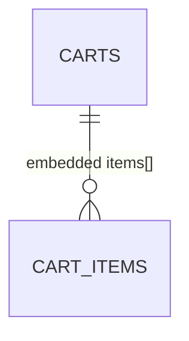

# Database — Cart Service

> Nguồn: `docs/lld/cart.md` · `docs/api/cart.md` · Code: chưa có repo (`ecommerce-taca/cart-service`) · Cập nhật: `2026-11-01`
> Trạng thái triển khai: ⏳ Chưa triển khai — tách từ Order-Commerce ngày 2026-11-01; toàn bộ nội dung là thiết kế.
> Baseline: MongoDB 8.x · database riêng `cartdb`

## 1. Quy ước chung

| Quy ước | Quyết định | Ràng buộc |
|---|---|---|
| ID | UUIDv7 dạng string (`_id`, `item_id`) | Cross-service ID (`product_id`, `sku_id`, `shop_id`, `buyer_user_id`) là reference, không join. |
| Money | Int64 VND | Chỉ là snapshot hiển thị. |
| Time | `Date` UTC | API ISO-8601 UTC. |
| Tenant | `buyer_user_id` | Mọi query lọc theo buyer từ auth context. |
| Lưu trữ | Durable, **không TTL index** | Quyết định 2026-11-01: giỏ lưu lâu dài. |
| Concurrency | Field `version` | Update có điều kiện `version`; lệch → `CART_VERSION_CONFLICT`. |

## 2. Quan hệ

`items` là mảng embedded trong document `carts` (tối đa 100 phần tử), không có collection riêng.

## 3. Chi tiết collection

### 3.1 `carts`

| Field | Kiểu | Bắt buộc | Ràng buộc |
|---|---|:--:|---|
| `_id` | string | Có | `cart_id`, UUIDv7. |
| `buyer_user_id` | string | Có | Unique; một giỏ mỗi buyer. |
| `items` | array | Có | ≤100 phần tử, xem §3.2. |
| `add_idempotency` | array | Không | Key gần đây của `POST /cart/items`: `{key, request_hash, response, expires_at}`; giữ 24h, tối đa 20 phần tử (bỏ phần tử cũ nhất). `checked-out` không cần lưu gì vì xoá theo `item_id` vốn an toàn khi gọi lại. |
| `version` | int64 | Có | Tăng mỗi lần ghi. |
| `created_at`, `updated_at` | Date | Có | UTC. |

### 3.2 `items[]`

| Field | Kiểu | Ràng buộc |
|---|---|---|
| `item_id` | string | UUIDv7, unique trong giỏ. |
| `product_id`, `sku_id`, `shop_id` | string | Reference Product Catalog; `sku_id` unique trong giỏ. |
| `quantity` | int32 | `1..999`. |
| `title_snapshot`, `sku_label_snapshot` | string | Cache hiển thị, cập nhật khi hydrate. |
| `unit_price_snapshot` | int64 | VND, cache hiển thị. |
| `available` | bool | Kết quả hydrate gần nhất. |
| `added_at`, `updated_at` | Date | UTC. |

## 4. Index

| Collection | Index |
|---|---|
| `carts` | unique `{buyer_user_id: 1}`; `{updated_at: 1}` (báo cáo/dọn dẹp sau này). Không có TTL index. |

## 5. Enum và rules

Không có enum. Rules: tối đa 100 dòng, quantity `1..999`, `sku_id` không lặp trong một giỏ — enforce ở service.

## 6. Migration và seed

⏳ Chưa có code. Index tạo bằng init script khi khởi động (ví dụ Mongock changeset `001-create-carts-indexes`).

| Seed (local/test) | Giá trị |
|---|---|
| `carts` | 1 giỏ rỗng; 1 giỏ 1 shop; 1 giỏ 3 shop (dùng cho golden test `CO-CALC-01`); 1 giỏ có SKU đã inactive (`available=false`); 1 giỏ đủ 100 dòng. |

Dữ liệu từ Redis cart cũ: không có (Order-Commerce chưa từng chạy), không cần migrate.

## 7. Giả định & câu hỏi mở

| # | Nội dung | Ảnh hưởng nếu sai | Cần ai xác nhận |
|---|---|---|---|
| 1 | Một document mỗi buyer, item embedded. | Nếu cần nhiều giỏ (lưu để mua sau) phải tách collection. | Product owner |
| 2 | Không TTL; chưa có chính sách xoá giỏ khi tài khoản bị xoá. | Dữ liệu cá nhân tồn tại vô thời hạn. | Security |
