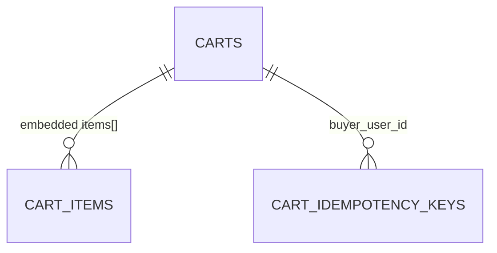

# Database — Cart Service

> Nguồn: `docs/lld/cart.md` · `docs/api/cart.md` · Code: chưa có repo (`ecommerce-taca/cart-service`) · Cập nhật: `2026-11-01`
> Trạng thái triển khai: ⏳ Chưa triển khai — tách từ Order-Commerce ngày 2026-11-01; toàn bộ nội dung là thiết kế.
> Baseline: MongoDB 8.x · database riêng `cartdb`

## 1. Quy ước chung

| Quy ước | Quyết định | Ràng buộc |
|---|---|---|
| ID | UUIDv7 dạng string (`_id`, `item_id`) | Cross-service ID (`product_id`, `sku_id`, `shop_id`, `buyer_user_id`) là reference, không join. |
| Money | Int64 VND | Chỉ là snapshot hiển thị. |
| Time | `Date` UTC | API ISO-8601 UTC. |
| Tenant | `buyer_user_id` | Mọi query lọc theo buyer từ auth context. |
| Lưu trữ | Durable, **không TTL index** | Quyết định 2026-11-01: giỏ lưu lâu dài. |
| Concurrency | Field `version` | Mỗi mutation cart dùng CAS `{buyer_user_id, _id, version}`; lỗi conflict retry hữu hạn, hết budget → `CART_VERSION_CONFLICT`. `item_revision` bảo vệ các thay đổi quantity khi Checkout cleanup. |

## 2. Quan hệ

`items` là mảng embedded trong document `carts` (tối đa 100 phần tử), không có collection riêng. Key idempotency của `POST /cart/items` nằm ở collection riêng `cart_idempotency_keys` (§3.1a). Một item có `item_revision` tăng khi quantity thực sự thay đổi; Checkout cleanup chỉ được xoá khi khớp revision đã đọc.

## 3. Chi tiết collection

### 3.1 `carts`

| Field | Kiểu | Bắt buộc | Ràng buộc |
|---|---|:--:|---|
| `_id` | string | Có | `cart_id`, UUIDv7. |
| `buyer_user_id` | string | Có | Unique; một giỏ mỗi buyer. |
| `items` | array | Có | ≤100 phần tử, xem §3.2. |
| `version` | int64 | Có | Tăng mỗi lần ghi. |
| `created_at`, `updated_at` | Date | Có | UTC. |

### 3.1a `cart_idempotency_keys`

Key của `POST /cart/items` (`docs/api/cart.md` §3.2). Collection riêng, **không giới hạn số key khác nhau**: key đã nhận còn hiệu lực đủ 24h. `checked-out` không cần collection riêng: chỉ xoá item khi khớp `(item_id, item_revision)` đã được Checkout snapshot; `checkout_group_id` chỉ để trace, không có exactly-once ledger.

| Field | Kiểu | Bắt buộc | Ràng buộc |
|---|---|:--:|---|
| `_id` | object | Có | `{buyer_user_id, key}` theo đúng thứ tự field cố định: unique tự nhiên. Cùng key sau expiry có thể được claim lại bằng conditional replacement. |
| `request_hash` | string | Có | SHA-256 hex của canonical JSON `{product_id,sku_id,quantity}` theo thứ tự cố định/UTF-8; key còn hạn, khác hash → `409 CART_IDEMPOTENCY_CONFLICT`. |
| `response` | object | Có | Toàn bộ response body HTTP `201` đã commit, bao gồm `meta.request_id` gốc; không bao giờ commit record thiếu response. |
| `response_status` | int32 | Có | HTTP `201` của request gốc; replay giữ nguyên status/body. |
| `expires_at` | Date | Có | `created_at + 24h`; TTL index chỉ dọn eventual, không quyết định thời điểm hết hạn nghiệp vụ. |
| `created_at` | Date | Có | UTC. |

Ghi key và cập nhật `carts` trong **một transaction MongoDB** (cần replica set, kể cả môi trường local). Trước transaction, validate body và Product/SKU; cùng key còn hạn thì có thể fast-path replay. **Trong transaction** đọc key theo `_id`: còn hạn (`expires_at > now`) → cùng hash replay HTTP 201/body gốc, khác hash 409; hết hạn (`expires_at <= now`) nhưng TTL chưa xoá → claim bằng `replaceOne` có filter gồm `_id` và `expires_at <= now`; chưa tồn tại → insert. Sau khi claim, đọc cart, enforce rules, CAS theo `version` **chỉ khi cart thực sự đổi** (ví dụ add vào quantity 999 là no-op), lưu `response_status=201` và response hoàn chỉnh vào key **kể cả no-op**, rồi commit nguyên tử. Trường hợp duplicate key, write conflict hoặc TTL xoá đồng thời và **đã biết transaction chưa commit**: abort và retry bounded (đọc lại key/trạng thái đã commit). Nếu kết quả commit chưa rõ, trước hết xác minh record key/hash và trạng thái đã commit để replay kết quả cũ; không khởi chạy mutation mới khi chưa phân định outcome, không thể xác minh do DB lỗi thì trả `503 CART_STORAGE_UNAVAILABLE`. Hai request đồng thời cùng key trong 24h chỉ cộng quantity một lần. Không bao giờ phụ thuộc MongoDB TTL monitor để giải phóng key đã hết hạn.

Các mutation không có `Idempotency-Key` chỉ cần CAS atomic trên một cart document. Tạo cart lần đầu qua insert với unique `buyer_user_id`; nếu ghi đụng độ **đã xác định thất bại** thì re-read, tính lại và retry hữu hạn. Với `POST` không key mà kết quả ghi chưa rõ (ví dụ mất ACK), không tự chạy lại phép cộng; trả `503 CART_STORAGE_UNAVAILABLE` khi không thể xác nhận, client đọc lại giỏ trước khi gửi thao tác mới. `GET /cart` chỉ hydrate trong response, không persist snapshot/không tăng `version`.

### 3.2 `items[]`

| Field | Kiểu | Ràng buộc |
|---|---|---|
| `item_id` | string | UUIDv7, unique trong giỏ. |
| `product_id`, `sku_id`, `shop_id` | string | Reference Product Catalog; `sku_id` unique trong giỏ. |
| `quantity` | int32 | `1..999`, cộng dồn khi POST SKU trùng và cap 999. |
| `item_revision` | int64 | Khởi tạo `1`, tăng 1 khi POST/PUT làm quantity **thực sự thay đổi**; dùng cho conditional checked-out. GET/no-op không tăng. |
| `title_snapshot`, `sku_label_snapshot` | string | Cache hiển thị từ lần ghi đã validate Product; hydrate GET response-only, **không lưu lại**; giới hạn độ dài input snapshot ở tầng ứng dụng để tránh phình document (ngưỡng cụ thể chốt khi implement, không đổi schema v1). |
| `unit_price_snapshot` | int64 | VND, cache hiển thị persisted; GET có thể dùng giá Product mới **chỉ trong response**, tính `line_total` từ giá response và quantity, không ghi đè DB. |
| `available` | bool | Snapshot best-effort tại lần ghi hợp lệ (Product active; Inventory không quyết định add). GET có thể override trong response cùng `availability_status` (response-only). |
| `added_at`, `updated_at` | Date | UTC; item `updated_at` chỉ đổi khi item thực sự được mutate. Sau DELETE + re-add SKU phải cấp `item_id` mới. |

## 4. Index

| Collection | Index |
|---|---|
| `carts` | unique `{buyer_user_id: 1}`; `{updated_at: 1}` (báo cáo/dọn dẹp sau này). Không có TTL index (giỏ không hết hạn). |
| `cart_idempotency_keys` | `_id` unique; TTL `{expires_at: 1}` với `expireAfterSeconds: 0`. MongoDB TTL dọn trễ; service so `expires_at` và cho phép conditional replacement của key đã hết hạn. Race với TTL/delete/claim khác phải retry bounded. |

## 5. Enum và rules

Không có enum trạng thái cart. Rules: một cart/buyer, tối đa 100 dòng, quantity `1..999`, `sku_id` không lặp trong một giỏ — enforce ở service. `item_revision >= 1`; no-op update không tăng revision; GET không mutate DB. `availability_status` là enum response-only (`AVAILABLE`, `OUT_OF_STOCK`, `PRODUCT_UNAVAILABLE`, `STALE`, `UNKNOWN`), không persist trong DB. Checkout chỉ được xoá item có revision khớp snapshot, không tự giảm quantity khi buyer vừa sửa.

## 6. Migration và seed

⏳ Chưa có code. Index tạo bằng init script khi khởi động (ví dụ Mongock changeset `001-create-carts-indexes`).

| Seed (local/test) | Giá trị |
|---|---|
| `carts` | 1 giỏ rỗng; 1 giỏ 1 shop; 1 giỏ 3 shop (dùng test `CART-API-06/07`); 1 giỏ có SKU đã inactive (`available=false`); 1 giỏ đủ 100 dòng; một giỏ có item được sửa giữa checkout để test revision. |
| `cart_idempotency_keys` | Key còn hiệu lực; key đã hết hạn nhưng TTL chưa dọn; 2 request cùng key; nhiều key K1…K21; record cùng key khác body. |

Dữ liệu từ Redis cart cũ: không có (Order-Commerce chưa từng chạy), không cần migrate.

## 7. Giả định & câu hỏi mở

| # | Nội dung | Ảnh hưởng nếu sai | Cần ai xác nhận |
|---|---|---|---|
| 1 | Một document mỗi buyer, item embedded. | Nếu cần nhiều giỏ (lưu để mua sau) phải tách collection. | Product owner |
| 2 | Không TTL; chưa có chính sách xoá giỏ khi tài khoản bị xoá. | Dữ liệu cá nhân tồn tại vô thời hạn. | Security |
| 3 | `item_revision` và `expected_item_revisions` là thay đổi contract so với Cart/Checkout ban đầu. | Cần cập nhật Checkout LLD/caller và contract test trước integration. | Checkout owner |
