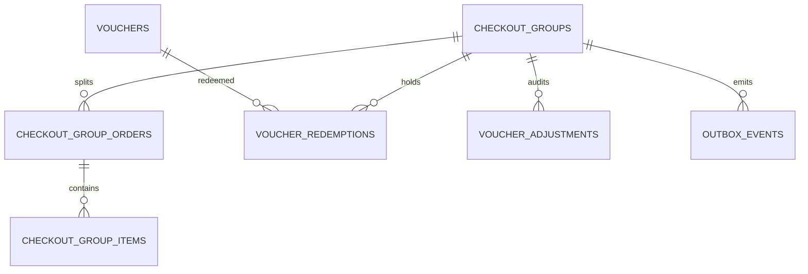

# Database — Checkout Service

> Nguồn: `docs/lld/checkout.md` · `docs/lld/voucher.md` · HLD `EcommercePlatform-v4(6).excalidraw` · Code: chưa có repo (`ecommerce-taca/checkout-service`) · Cập nhật: `2026-11-01`
> Trạng thái triển khai: ⏳ Chưa triển khai — tách từ Order-Commerce ngày 2026-11-01; toàn bộ nội dung là thiết kế, dùng làm spec cho lần triển khai đầu.
> Baseline: MySQL 8.4/InnoDB · database riêng `checkoutdb`

Tài liệu này là **tổng quan** DB của Checkout Service: quy ước, quan hệ, bảng checkout, bảng dùng chung, migration và seed. Bảng voucher chi tiết ở `docs/db/voucher.md`.

## 1. Quy ước chung

| Quy ước | Quyết định | Ràng buộc |
|---|---|---|
| ID | UUIDv7 canonical string ở API, `BINARY(16)` trong MySQL | Cross-service ID (`order_id`, `buyer_user_id`, `shop_id`, `reservation_id`) là reference, không FK. |
| Money | `BIGINT` integer VND | Không FLOAT; currency `VND`. |
| Time | `DATETIME(6)` UTC | API/event ISO-8601 UTC. |
| Tenant | Buyer `buyer_user_id`, seller `shop_id` | Query luôn scope theo auth context. |
| Transaction | InnoDB | Group + voucher hold + outbox + idempotency atomic trong local DB. |
| Không lưu | Order lifecycle, invoice, payment | Thuộc `order-service`; Checkout chỉ giữ số tiền phân bổ cần cho recalculate. |

## 2. Quan hệ

`order_id` trong `checkout_group_orders`/`voucher_redemptions` trỏ sang `orderdb` của `order-service` — reference, không FK.

## 3. Chi tiết bảng

### 3.1 `checkout_groups`

| Cột | Type | Null | Ràng buộc |
|---|---|---:|---|
| `id` | BINARY(16) | N | PK = `checkout_group_id`. |
| `buyer_user_id` | BINARY(16) | N | Auth reference. |
| `cart_id` | VARCHAR(64) | N | Reference `cart-service`. |
| `idempotency_key` | VARCHAR(128) | N | Key của `POST /checkout`. |
| `payment_method` | VARCHAR(16) | N | `VNPAY`/`COD`. |
| `status` | VARCHAR(16) | N | `CheckoutGroupStatus`. |
| `voucher_ids` | JSON | N | `voucher_id` buyer gửi trong `POST /checkout`. |
| `grand_total` | BIGINT | N | Tổng nhóm tại lúc place. |
| `order_create_request` | JSON | Y | Body `POST /internal/orders` nguyên văn (`order-docs/docs/api/order.md` §3.7), ghi một lần sau khi reserve xong, trước lần gọi Order đầu tiên; bất biến sau đó. Reconcile gửi lại đúng body này (`docs/lld/checkout.md` §3.5). Chứa PII (email, SĐT, địa chỉ): không log, xoá sau `ORDER_CREATE_REQUEST_RETENTION`. |
| `failure_reason` | VARCHAR(64) | Y | Mã lỗi khi `FAILED`. |
| `created_at/updated_at` | DATETIME(6) | N | UTC. |
| `version` | BIGINT | N | Optimistic lock. |

### 3.2 `checkout_group_orders`

Số tiền phân bổ của từng đơn con tại lúc place, dùng làm đầu vào cho recalculate (`docs/lld/voucher.md` §3.3).

| Cột | Type | Null | Ràng buộc |
|---|---|---:|---|
| `checkout_group_id` | BINARY(16) | N | FK → `checkout_groups`. |
| `order_id` | BINARY(16) | N | Checkout sinh trước khi gọi `order-service`; PK cùng `checkout_group_id`. |
| `shop_id` | BINARY(16) | N | — |
| `reservation_id` | BINARY(16) | Y | Inventory reference, có sau bước reserve. **Mỗi đơn con một reservation** (`docs/lld/checkout.md` §6.1). |
| `subtotal`, `shop_discount`, `platform_discount`, `shipping_fee`, `freeship_discount`, `tax`, `grand_total` | BIGINT | N | `≥0`; `grand_total = subtotal − shop_discount − platform_discount + shipping_fee − freeship_discount`; v1 không đổi sau place (`docs/lld/voucher.md` §3.3). |
| `absorbed_amount` | BIGINT | N | Mặc định 0; phần giảm sàn chịu khi mã không còn đủ `min_order` sau huỷ một phần. Chỉ để đối soát, không nằm trong công thức `grand_total`. |
| `status` | VARCHAR(16) | N | `ACTIVE`/`CANCELLED`. |
| `updated_at` | DATETIME(6) | N | UTC. |

### 3.2a `checkout_group_items`

Snapshot **bất biến** từng dòng hàng lúc place. Recalculate cần nó để chạy lại `CheckoutCalculator` theo dòng (thuế suất có thể khác nhau giữa các dòng) và trả phân bổ mới về từng dòng cho `order-service`.

| Cột | Type | Null | Ràng buộc |
|---|---|---:|---|
| `order_item_id` | BINARY(16) | N | PK. Checkout sinh trước (UUIDv7) và gửi sang `order-service`; `order_items.id` dùng đúng giá trị này. |
| `checkout_group_id` | BINARY(16) | N | FK → `checkout_groups`. |
| `order_id` | BINARY(16) | N | FK `(checkout_group_id, order_id)` → `checkout_group_orders`. |
| `product_id`, `sku_id` | BINARY(16) | N | Reference Product Catalog. |
| `unit_price` | BIGINT | N | `≥1`, giá đã gồm VAT tại lúc place. |
| `quantity` | INT | N | 1–999. |
| `tax_rate_bps` | INT | N | Snapshot từ Product Catalog (`docs/lld/checkout.md` §6.3). |
| `discount_allocated`, `tax_amount` | BIGINT | N | Kết quả tính lúc place; v1 không đổi sau đó (`docs/lld/voucher.md` §3.3). |

### 3.3 Bảng voucher

`vouchers`, `voucher_redemptions`, `voucher_adjustments` — `docs/db/voucher.md` §3.

### 3.4 `outbox_events` và `idempotency_keys`

| Bảng | Field chính | Rules |
|---|---|---|
| `outbox_events` | event_id, aggregate_type/id, event_type, schema_version, payload JSON, occurred_at, published_at, attempt_count, last_error, dlq_at | Unique event_id; retry 3/backoff 2s rồi DLQ; payload redacted. Cũng dùng cho job gọi `cart-service` `checked-out` (event nội bộ `cart.checked_out_requested`, không publish Kafka). |
| `idempotency_keys` | key, user_id, operation, request_hash, response_snapshot JSON, status, expires_at | PK `(key,user_id,operation)`; payload khác → conflict; giữ 24h. `operation` gồm `PLACE_CHECKOUT`, `VOUCHER_MUTATION`, `RECALCULATE` (user_id = `order-service`). |

## 4. Index

| Bảng | Index |
|---|---|
| `checkout_groups` | unique `(buyer_user_id, idempotency_key)`; `(status, updated_at)` cho job reconcile. |
| `checkout_group_orders` | PK `(checkout_group_id, order_id)`; unique `order_id`. |
| `checkout_group_items` | PK `order_item_id`; `(checkout_group_id, order_id)`. |
| `outbox_events` | `(published_at, occurred_at)`; `(aggregate_type, aggregate_id, occurred_at)` |
| `idempotency_keys` | PK `(key,user_id,operation)`; `expires_at` |

Index bảng voucher ở `docs/db/voucher.md` §4.

## 5. Enum và rules

`CheckoutGroupStatus`, `GroupOrderStatus` ở `docs/lld/checkout.md` §5. Bất biến tiền và usage limit enforce ở service transaction.

## 6. Migration và seed

### 6.1 Thứ tự migration

⏳ Repo chưa có migration; thứ tự dưới đây là thiết kế cho Flyway `V00x__*.sql`.

| Thứ tự | Nội dung | Phụ thuộc |
|---:|---|---|
| 001 | Tạo database `checkoutdb`, charset/collation | — |
| 002 | Tạo `vouchers` (unique normalized `code` theo scope/shop) | — |
| 003 | Tạo `checkout_groups` | — |
| 004 | Tạo `checkout_group_orders`, FK → `checkout_groups`; tạo `checkout_group_items`, FK → `checkout_group_orders` | `checkout_groups` |
| 005 | Tạo `voucher_redemptions`, FK → `vouchers`, `checkout_groups` | 002, 003 |
| 006 | Tạo `voucher_adjustments`, FK → `checkout_groups` | 003 |
| 007 | Tạo `outbox_events` | — |
| 008 | Tạo `idempotency_keys` | — |
| 009 | Index §4 và `docs/db/voucher.md` §4 | Tất cả |
| 010 | Seed local/test (§6.2) | Tất cả |

### 6.2 Seed tối thiểu cho local/test

| Seed | Giá trị |
|---|---|
| `vouchers` | `APPLE300K` (SHOP, FIXED 300k), `TACA200K` (PLATFORM, FIXED 200k, `min_order` 900k), `FREESHIPMAX` (FREESHIP, 60k) cho golden `CO-CALC-01`; 1 `SHOP` `PERCENT` có `max_discount_amount`; 1 `EXPIRED`; 1 hết `usage_limit`. |
| `checkout_groups` | 1 `ORDERS_CREATED` 2 đơn (golden), 1 `FAILED`, 1 `RECONCILING`. |
| `voucher_redemptions` | Đủ `HELD`, `REDEEMED`, `RELEASED`. |
| `idempotency_keys` | 1 key `PLACE_CHECKOUT` còn hạn. |

## 7. Giả định & câu hỏi mở

| # | Nội dung | Ảnh hưởng nếu sai | Cần ai xác nhận |
|---|---|---|---|
| 1 | MySQL 8.4/InnoDB (giữ lựa chọn của Order-Commerce). | Ảnh hưởng SQL/migration/lock. | Tech lead |
| 2 | Checkout giữ bản sao số tiền phân bổ (`checkout_group_orders`) để recalculate, còn `order-service` giữ số tiền chính thức trên đơn. Hai bản phải bằng nhau sau mỗi lần recalculate. | Lệch thì hoá đơn khác voucher audit; cần job đối soát. | Finance/Architecture |
