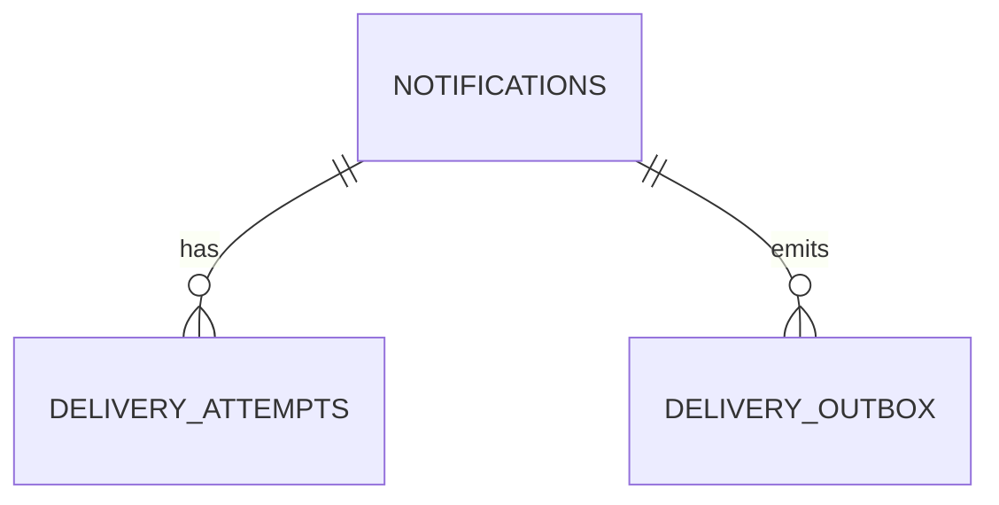

# Database — Notification Service

> Nguồn: `docs/lld/notification.md` · HLD `EcommercePlatform-v4(6).excalidraw` · Code: `ecommerce-taca/notification-service` @ `main` (`6c6d9a2`) · Cập nhật: `2026-10-31`
> Trạng thái triển khai: 🟡 Triển khai một phần — consumer Kafka, delivery Email/In-app + retry/outbox, notification center, preference và admin deliveries đã có code; retention, audit, metrics và một số mapping event/template chưa có.
> Engine/DB: MySQL 8 + TypeORM `notificationdb` (InnoDB, `utf8mb4_unicode_ci`); `synchronize=false`, schema chỉ đổi qua migration ở `src/infrastructure/persistence/migrations`

## 1. Quy ước chung

| Quy ước | Quyết định | Ràng buộc |
|---|---|---|
| ID | Cột `_id` `VARCHAR(36)`, UUIDv7 sinh ở app | Seed local dùng ID dễ đọc (`ntf-*`, `tpl-*`), không phải UUIDv7. |
| Time | `DATETIME(6)` UTC (TypeORM `timezone: 'Z'`) | API/event ISO-8601 UTC. |
| Enum | MySQL `ENUM` | Thêm giá trị phải qua migration `MODIFY`. |
| Source | Kafka command/event | Notification không là source của order/payment. |
| Payload | `notifications.data` chỉ giữ field có trong placeholder template | Không lưu secret/OTP/password/payment credential. |
| Recipient | `recipient_encrypted` (AES-256-GCM) + `recipient_hash` (HMAC-SHA256) | Không lưu plaintext email. |
| Retention | Baseline in-app 90 ngày | **Chưa có job xoá/archive** ở v1. |

## 2. Quan hệ

- FK thật duy nhất: `delivery_attempts.notification_id → notifications._id` (`fk_attempts_notification`).
- `delivery_outbox.aggregate_id` trỏ `notifications._id` nhưng không có FK.
- `notifications.template_key/template_version` khớp `templates.key/version` theo logic, không có FK.
- `notification_preferences` keyed theo `user_id`; `processed_events`, `notification_audits` độc lập.

## 3. Chi tiết bảng

### 3.1 `notifications`

| Field | Type | Ràng buộc |
|---|---|---|
| `_id` | VARCHAR(36) | PK, UUIDv7. |
| `recipient_user_id` | VARCHAR(36) | NOT NULL; user ID từ event/command. |
| `recipient_encrypted` | TEXT | Nullable; `base64(iv‖tag‖ciphertext)` AES-256-GCM; null với `IN_APP`. |
| `recipient_hash` | CHAR(64) | Nullable; HMAC-SHA256 hex của email `trim().toLowerCase()`; null với `IN_APP`. |
| `channel` | ENUM | `EMAIL`, `IN_APP`. |
| `template_key` | VARCHAR(100) | NOT NULL. |
| `template_version` | INT | NOT NULL; version template lúc ingest. |
| `dedupe_key` | VARCHAR(255) | NOT NULL; command → `dedupe_key`, domain event → `event_id`. |
| `source_event_id` | VARCHAR(64) | Nullable; `event_id` của command/event. |
| `category` | ENUM | `ORDER`, `SHIPMENT`, `PAYMENT`, `REVIEW`, `CONVERSATION`, `SHOP`, `SECURITY`, `MARKETING`. |
| `reference_type` | ENUM | Nullable; `ORDER`, `SHIPMENT`, `PAYMENT`, `REVIEW`, `CONVERSATION`, `SHOP`. |
| `reference_id` | VARCHAR(64) | Nullable. |
| `data` | JSON | Nullable; đã lọc allowlist. |
| `status` | ENUM | `QUEUED`, `PROCESSING`, `SENT`, `FAILED`, `SKIPPED`, `EXPIRED`. |
| `read_status` | ENUM | Nullable; `UNREAD`/`READ` với `IN_APP`, null với `EMAIL`. |
| `scheduled_at` | DATETIME(6) | Nullable; set = thời điểm ingest. |
| `processing_started_at` | DATETIME(6) | Nullable; lease khi claim `PROCESSING`, set null khi finalize. |
| `sent_at` | DATETIME(6) | Nullable. |
| `created_at` | DATETIME(6) | Default `CURRENT_TIMESTAMP(6)`. |
| `updated_at` | DATETIME(6) | Default + `ON UPDATE CURRENT_TIMESTAMP(6)`. |

Không có cột `version` (mark-read không dùng optimistic lock).

### 3.2 `delivery_attempts`

| Field | Type | Ràng buộc |
|---|---|---|
| `_id` | VARCHAR(36) | PK. |
| `notification_id` | VARCHAR(36) | FK → `notifications._id`. |
| `attempt_no` | INT | Đơn điệu tăng theo notification, 1..`DELIVERY_RETRY_COUNT` (+1 khi chốt `RETRY_EXHAUSTED` lúc reclaim). |
| `provider` | VARCHAR(32) | `smtp` hoặc `in_app`. |
| `status` | ENUM | `STARTED`, `SENT`, `SKIPPED`, `RETRYABLE_FAILED`, `RETRY_EXHAUSTED`, `PERMANENT_FAILED`. |
| `provider_message_id` | VARCHAR(255) | Nullable; SMTP `messageId`. |
| `error_code` | VARCHAR(64) | Nullable; `SMTP_*` hoặc `NOTIFICATION_*`. |
| `started_at` / `finished_at` | DATETIME(6) | Nullable. |
| `trace_id` / `request_id` | VARCHAR(64) | Nullable; từ header Kafka. |

Không lưu rendered body/raw provider response. Không có cột `provider_status` — API admin suy ra từ `status` (xem `docs/api/notification.md` §3.7).

### 3.3 `notification_preferences`

| Field | Type | Ràng buộc |
|---|---|---|
| `_id` | VARCHAR(36) | PK. |
| `user_id` | VARCHAR(36) | NOT NULL. |
| `channel` | ENUM | `EMAIL`, `IN_APP`. |
| `category` | ENUM | Như `notifications.category`. |
| `status` | ENUM | `ENABLED`, `DISABLED`. |
| `locked` | TINYINT(1) | Default `0`; `1` cấm opt-out, tự set cho `SECURITY`. |
| `version` | INT | Default `1`, +1 mỗi lần update. |
| `updated_at` | DATETIME(6) | Default + on update. |

Unique `(user_id, channel, category)`.

### 3.4 `templates`

| Field | Type | Ràng buộc |
|---|---|---|
| `_id` | VARCHAR(36) | PK. |
| `key` | VARCHAR(100) | NOT NULL. |
| `version` | INT | NOT NULL. |
| `locale` | VARCHAR(16) | Hiện chỉ `vi-VN`. |
| `subject` | VARCHAR(255) | Handlebars, placeholder `{{field}}`. |
| `body` | TEXT | Handlebars. |
| `status` | ENUM | `DRAFT`, `PUBLISHED`; chỉ `PUBLISHED` được resolve. |
| `created_at` | DATETIME(6) | Default. |

Chưa có API/luồng quản trị template; tạo/sửa qua seed hoặc SQL.

### 3.5 `processed_events`

`_id` VARCHAR(36) PK · `event_id` VARCHAR(64) unique · `dedupe_key` VARCHAR(255) unique · `processed_at` DATETIME(6) · `status` ENUM(`PROCESSED`,`FAILED`) · `error` VARCHAR(255) nullable. Ghi cả event không map (dedupe_key = event_id). Code hiện chỉ ghi `PROCESSED`.

### 3.6 `notification_audits`

`_id` · `actor_user_id` VARCHAR(36) nullable · `action` VARCHAR(64) · `target_type` VARCHAR(32) · `target_id` VARCHAR(64) · `reason` VARCHAR(1000) nullable · `metadata` JSON nullable · `occurred_at` DATETIME(6). Bảng và repository có sẵn nhưng **chưa có luồng nào ghi** ở v1.

### 3.7 `delivery_outbox`

| Field | Type | Ràng buộc |
|---|---|---|
| `_id` | VARCHAR(36) | PK = `eventId` của delivery status event. |
| `aggregate_id` | VARCHAR(36) | `notifications._id`. |
| `event_type` | VARCHAR(64) | `notification.delivered` / `notification.failed`. |
| `payload` | JSON | `DeliveryStatusEvent` camelCase (`eventId`, `outcome`, `dedupeKey`, `notificationId`, `channel`, `templateKey`, `errorCode`, `occurredAt`). |
| `created_at` | DATETIME(6) | Default. |
| `published_at` | DATETIME(6) | Null tới khi relay publish thành công. |
| `retry_count` | INT | Default 0; `+1` atomic mỗi lần publish lỗi, không có giới hạn. |

Ghi cùng một transaction với update `notifications.status` (`SENT`/`FAILED`) và insert attempt cuối.

## 4. Index

| Bảng | Index |
|---|---|
| `notifications` | unique `uq_notifications_recipient_dedupe_channel (recipient_user_id, dedupe_key, channel)`; `idx_notifications_recipient_created (recipient_user_id, created_at)`; `idx_notifications_recipient_read_created (recipient_user_id, read_status, created_at)`; `idx_notifications_status_scheduled (status, scheduled_at)`; `idx_notifications_recipient_hash (recipient_hash)`; `idx_notifications_status_processing (status, processing_started_at)` |
| `delivery_attempts` | `idx_attempts_notification_no (notification_id, attempt_no)`; `idx_attempts_status_started (status, started_at)` |
| `notification_preferences` | unique `uq_preferences_user_channel_category (user_id, channel, category)` |
| `templates` | unique `uq_templates_key_version_locale (key, version, locale)`; `idx_templates_key_status (key, status)` |
| `processed_events` | unique `uq_processed_events_event_id (event_id)`; unique `uq_processed_events_dedupe_key (dedupe_key)`; `idx_processed_events_processed_at (processed_at)` |
| `notification_audits` | `idx_audits_target_occurred (target_id, occurred_at)`; `idx_audits_actor_occurred (actor_user_id, occurred_at)` |
| `delivery_outbox` | `idx_delivery_outbox_pending (published_at, created_at)` |

## 5. Enum và rules

- Enum khớp `docs/lld/notification.md` §5.
- Tổng số lần gửi tối đa `DELIVERY_RETRY_COUNT=3` (gồm lần đầu).
- Một event map nhiều channel tạo nhiều row `notifications` cùng `dedupe_key`, khác `channel`.
- Claim `PROCESSING` bằng `UPDATE` có điều kiện (atomic); sweeper chỉ chọn ứng viên.
- Unread count = `COUNT(*)` row `IN_APP` + `UNREAD`, không lưu counter riêng nên không âm.

## 6. Migration và seed

### 6.1 Thứ tự migration

| Thứ tự | File | Nội dung | Phụ thuộc |
|---:|---|---|---|
| 001 | `1750000000001-init-database` | `SET NAMES utf8mb4 COLLATE utf8mb4_unicode_ci` (DB được tạo ngoài migration). | — |
| 002 | `1750000000002-create-templates` | Bảng `templates` + unique/index. | — |
| 003 | `1750000000003-create-notifications` | Bảng `notifications` (chưa có index phụ). | — |
| 004 | `1750000000004-create-delivery-attempts` | Bảng `delivery_attempts`, FK → `notifications`, enum status 4 giá trị. | 003 |
| 005 | `1750000000005-create-notification-preferences` | Bảng `notification_preferences` + unique. | — |
| 006 | `1750000000006-create-notification-audits` | Bảng `notification_audits` + index. | — |
| 007 | `1750000000007-create-processed-events` | Bảng `processed_events` + unique. | — |
| 008 | `1750000000008-add-notifications-indexes` | 5 index `notifications` (unique dedupe, recipient/created, recipient/read/created, status/scheduled, recipient_hash). | 003 |
| 009 | `1750000000009-delivery-hardening` | Mở rộng enum `delivery_attempts.status` (+`SKIPPED`, `RETRY_EXHAUSTED`); thêm `notifications.processing_started_at`; tạo `delivery_outbox`. | 004, 003 |
| 010 | `1750000000010-add-notifications-processing-index` | Index `(status, processing_started_at)`. | 009 |

Chạy: `npm run migration:run` (TypeORM CLI, `src/infrastructure/persistence/data-source.ts`).

### 6.2 Seed tối thiểu cho local/test

`npm run seed` (`src/infrastructure/persistence/seed.ts`), upsert theo ID cố định nên chạy lại được.

| Seed | Giá trị |
|---|---|
| `templates` (12, `version=1`, `vi-VN`, `PUBLISHED`) | `order-success-v1`, `payment-received-v1`, `order-cancelled-v1`, `invoice-issued-v1`, `shipment-delivered-v1`, `shipment-failed-v1`, `payment-result-v1`, `payout-result-v1`, `auth-verification-v1`, `auth-email-verification-v1`, `auth-password-reset-v1`, `review-request-v1`. |
| `notification_preferences` | `user-1` `EMAIL`/`SECURITY` `ENABLED` `locked=1`; `user-2` `EMAIL`/`MARKETING` `DISABLED`. |
| `notifications` | `ntf-sent-unread` (IN_APP, SENT, UNREAD, `order-success-v1`); `ntf-sent-read` (IN_APP, SENT, READ, `shipment-delivered-v1`); `ntf-failed` (EMAIL, FAILED, `payout-result-v1`); `ntf-skipped` (EMAIL, SKIPPED, `review-request-v1`, category MARKETING). |
| `delivery_attempts` | 3 attempt cho `ntf-failed`: #1, #2 `RETRYABLE_FAILED`/`SMTP_TIMEOUT`, #3 `PERMANENT_FAILED`/`SMTP_MAILBOX_UNAVAILABLE`. |
| `processed_events` | `evt-001` / `order:order-001:confirm` — test dedupe. |

Chưa seed: `message-received-v1`, `payment-expired-v1`, `payment-refunded-v1`; notification `EXPIRED`. Seed không chứa email thật/secret; notification seed không có `recipient_encrypted`.

### 6.3 Kiểm tra bắt buộc trước khi chạy migration production

1. Tạo database `notificationdb` (charset `utf8mb4`) và user trước khi chạy 001.
2. Trước 008: verify không trùng `(recipient_user_id, dedupe_key, channel)`.
3. Trước 009: verify không có job ghi `delivery_attempts` đang chạy (ALTER enum lock bảng).
4. Reconcile mọi `template_key` đang dùng trong `notifications` có trong `templates` (không có FK).

## 7. Giả định & câu hỏi mở

| # | Nội dung | Ảnh hưởng nếu sai | Cần ai xác nhận |
|---|---|---|---|
| 1 | MySQL/NestJS, Email + In-app theo lựa chọn 1C. | Ảnh hưởng schema/ops. | Tech lead |
| 2 | Retention 90 ngày chưa implement; bảng `notifications`/`delivery_outbox`/`processed_events` tăng không giới hạn. | Storage/privacy. | Product/Security |
| 3 | Template thiếu seed (`message-received-v1`, `payment-expired-v1`, `payment-refunded-v1`). | Command/event tương ứng không gửi được. | Notification owner |
| 4 | `delivery_outbox` row đã publish không bị xoá; `retry_count` không có ngưỡng alert/DLQ. | Outbox phình, event lỗi lặp vô hạn. | Platform owner |
