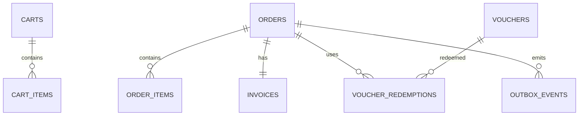

# Database — Order-Commerce Service

> Nguồn: `docs/lld/order-commerce.md` · HLD `EcommercePlatform-v4(6).excalidraw` · Cập nhật: `2026-10-31`
> Baseline: MySQL 8.4/InnoDB `orderdb` + Redis cart

Tài liệu này là **tổng quan** DB: quy ước, quan hệ, bảng dùng chung, migration và seed. Chi tiết bảng nghiệp vụ tách ra `docs/db/cart.md`, `docs/db/order.md`, `docs/db/voucher.md`.

## 1. Quy ước chung

| Quy ước | Quyết định | Ràng buộc |
|---|---|---|
| ID | UUIDv7 canonical string ở API, `BINARY(16)` trong MySQL | Cross-service IDs là reference, không FK. |
| Money | `BIGINT` integer VND | Không dùng FLOAT; currency bắt buộc `VND`. |
| Time | `DATETIME(6)` UTC | API/event ISO-8601 UTC. |
| Tenant | Buyer `buyer_user_id`, seller `shop_id` | Query luôn scope theo auth context. |
| Snapshot | Product title/sku/shop/price, address snapshot | Order history không phụ thuộc dữ liệu hiện tại của service khác. |
| Transaction | InnoDB transaction | Order/items/invoice/outbox/idempotency atomic trong local DB. |
| Redis | Key `cart:{user_id}`, TTL 30 ngày | Không lưu order source of truth/reservation ledger. |
| Observability | JSON log + W3C trace + X-Request-ID | Redact payment credential/raw address/token/order payload. |

## 2. Quan hệ

Cross-service Product/Inventory/Payment/Shipment/Auth chỉ dùng reference ID/API/event; không tạo FK sang database khác.

## 3. Chi tiết bảng

### 3.1 Bảng theo nghiệp vụ

| Bảng / key | Tài liệu |
|---|---|
| Redis `cart:{buyer_user_id}` | `docs/db/cart.md` §3.1 |
| `orders`, `order_items`, `invoices` | `docs/db/order.md` §3 |
| `vouchers`, `order_vouchers`, `voucher_redemptions` | `docs/db/voucher.md` §3 |
| `outbox_events`, `idempotency_keys` | §3.2 dưới đây (dùng chung mọi nghiệp vụ) |

### 3.2 `outbox_events` và `idempotency_keys`

| Bảng | Field chính | Rules |
|---|---|---|
| `outbox_events` | event_id, aggregate_type/id, event_type, schema_version, payload JSON, occurred_at, published_at, attempt_count, last_error, dlq_at | Unique event_id; retry 3/backoff 2s; payload redacted. |
| `idempotency_keys` | key, user_id, operation, request_hash, response_snapshot JSON, status, expires_at | Key + user + operation unique; payload khác conflict; retention 24h. |

## 4. Index

| Bảng | Index |
|---|---|
| `outbox_events` | `(published_at,occurred_at)`; `(aggregate_type,aggregate_id,occurred_at)` |
| `idempotency_keys` | PK `(key,user_id,operation)`; `expires_at` |

Index của bảng nghiệp vụ nằm ở §4 của file tương ứng.

## 5. Enum và rules

Order transition, voucher usage, total reconciliation, one buyer/one shop scope và idempotency phải enforce ở service transaction; schema enum chỉ là lớp đầu.

## 6. Migration và seed

### 6.1 Thứ tự migration

| Thứ tự | Nội dung | Phụ thuộc |
|---:|---|---|
| 001 | Tạo database `orderdb`, charset/collation, migration metadata | — |
| 002 | Tạo `vouchers` (unique normalized `code`) | — |
| 003 | Tạo `orders` (unique `order_number`) | — |
| 004 | Tạo `order_items`, FK → `orders` | `orders` |
| 005 | Tạo `order_vouchers` (unique `(order_id,scope)`), FK → `orders`, `vouchers` | `orders`, `vouchers` |
| 006 | Tạo `voucher_redemptions` (unique `(voucher_id,user_id,order_id)`) | `vouchers`, `orders` |
| 007 | Tạo `invoices` (unique `order_id`, unique `invoice_number`) | `orders` |
| 008 | Tạo `outbox_events` | — |
| 009 | Tạo `idempotency_keys` (PK `(key,user_id,operation)`) | — |
| 010 | Thêm index `(buyer_user_id,created_at)`, `(shop_id,status,created_at)` trên `orders`; `(scope,status,starts_at,expires_at)` trên `vouchers` | Tất cả bảng trên |
| 011 | Thêm cột `tax_rate_bps`, `tax_amount`, `discount_allocated` trên `order_items` (nếu deploy tăng dần từ schema cũ) | `order_items` |
| 012 | Seed fixture cho local/test (§6.2) | Tất cả bảng trên |

Redis cart (`docs/db/cart.md`) không có migration SQL — key theo TTL, không cần schema versioning.

### 6.2 Seed tối thiểu cho local/test

| Seed | Giá trị |
|---|---|
| `vouchers` | 1 `PLATFORM` `FIXED`; 1 `SHOP` `PERCENT` có `max_discount_amount`; 1 `FREESHIP`; 1 đã `EXPIRED`; 1 đã hết `usage_limit`. |
| `orders` | 1 mỗi `OrderStatus` (`PENDING_PAYMENT`, `CONFIRMED` cả nhánh VNPAY lẫn COD, `PROCESSING`, `SHIPPED`, `DELIVERED`, `CANCELLED`) — xem golden test `O-COD-01..10` ở `docs/test/order.md`, `O-CALC-01..15` ở `docs/test/checkout.md`. |
| `order_items` | Có `tax_rate_bps` khác nhau (10%, 5%, 0%) trên cùng 1 order — test tách thuế theo dòng. |
| `order_vouchers` | Order mẫu có đủ 3 dòng (`PLATFORM`+`SHOP`+`FREESHIP`) khớp ví dụ golden ở `docs/lld/checkout.md` §2.2. |
| `invoices` | 1 `PENDING`; 1 `ISSUED` có `pdf_url`. |
| `idempotency_keys` | 1 key đã dùng cho `POST /checkout`, còn hạn 24h. |

Không seed payment credential/address thật — dùng snapshot giả lập; không hard-delete order history trong seed/rollback script.

### 6.3 Kiểm tra bắt buộc trước khi chạy migration production

1. Reconcile: mọi `order.grand_total` phải khớp công thức `docs/lld/checkout.md` §2.2 trên dữ liệu hiện có trước khi thêm CHECK constraint `grand_total >= 0`.
2. Verify `Σ order_vouchers.discount_amount = orders.discount` cho mọi order — bất biến bắt buộc từ `docs/lld/checkout.md` §2.2.
3. Orphan detection: `order_items`/`invoices` không có `order_id` mồ côi trước khi thêm FK.

## 7. Giả định & câu hỏi mở

| # | Nội dung | Ảnh hưởng nếu sai | Cần ai xác nhận |
|---|---|---|---|
| 1 | MySQL 8.4/InnoDB được chọn để giải quyết mâu thuẫn MySQL/PostgreSQL trong HLD. | Ảnh hưởng SQL/migration/lock. | Architecture/Tech lead |
| 2 | Cart Redis TTL 30 ngày, không durable order state. | Ảnh hưởng cart recovery/cross-device. | Product owner |
| 3 | Address snapshot lưu JSON trong order; Auth User vẫn source address. | Ảnh hưởng privacy/schema/report. | Security/Order owner |
| 4 | ~~Chưa có stacking policy~~ → **Đã chốt**: mô hình 3 slot (`PLATFORM` + `SHOP`/shop + `FREESHIP`), tối đa 1 mã mỗi `scope`, thứ tự áp dụng và phân bổ ở `docs/lld/checkout.md` §2.2. Bảng `vouchers` **không có** cột audience/segment trong v1 (voucher chỉ theo mã); các màn Penpot Seller voucher targeting ngoài v1. | Nếu bật targeting cần bảng `voucher_audiences` mới. | Đã đóng |
| 5 | Invoice PDF generation/storage provider chưa chốt. | Ảnh hưởng `pdf_url`, async state và retention. | Finance/DevOps |
