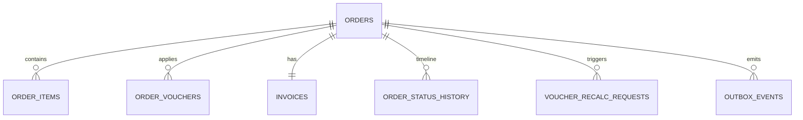

# Database — Order Service

> Nguồn: `docs/lld/order.md` · `docs/api/order.md` · HLD `EcommercePlatform-v4(6).excalidraw` · Code: `ecommerce-taca/order-commerce-service` @ `main` (`bf512b5`, chỉ có `README.md`) · Cập nhật: `2026-11-01`
> Trạng thái triển khai: ⏳ Chưa triển khai — tách từ Order-Commerce ngày 2026-11-01; toàn bộ nội dung là thiết kế.
> Baseline: MySQL 8.4/InnoDB · database riêng `orderdb`

## 1. Quy ước chung

| Quy ước | Quyết định | Ràng buộc |
|---|---|---|
| ID | UUIDv7 canonical string ở API, `BINARY(16)` trong MySQL | Cross-service ID là reference, không FK (kể cả `voucher_id` sang `checkoutdb`). |
| Money | `BIGINT` integer VND | Không FLOAT; currency `VND`. |
| Time | `DATETIME(6)` UTC | API/event ISO-8601 UTC. |
| Tenant | Buyer `buyer_user_id`, seller `shop_id` | Query luôn scope theo auth context. |
| Snapshot | Product title/sku/shop/price, thuế, address, voucher đã áp | Lịch sử đơn không phụ thuộc dữ liệu hiện tại của service khác. |
| Transaction | InnoDB | Order/items/vouchers/invoice/history/outbox/idempotency atomic. |
| Observability | JSON log + W3C trace + `X-Request-ID` | Redact payment credential/raw address/token. |

## 2. Quan hệ

Không còn bảng giỏ hay `vouchers`/`voucher_redemptions` (đã sang `cart-service`/`checkout-service`).

## 3. Chi tiết bảng

### 3.1 `orders`

| Cột | Type | Null | Ràng buộc |
|---|---|---:|---|
| `id` | BINARY(16) | N | PK UUIDv7, do `checkout-service` sinh. |
| `order_number` | VARCHAR(32) | N | Unique, hiển thị; cũng là `order_code` trong event/Shipment. |
| `checkout_group_id` | BINARY(16) | N | Liên kết đơn con multi-shop. |
| `buyer_user_id` | BINARY(16) | N | Auth reference. |
| `buyer_email` | VARCHAR(254) | N | Snapshot từ Checkout; dùng cho `payload.buyer.email` và `buyer_email` bắt buộc của Shipment. |
| `shop_id` | BINARY(16) | N | — |
| `shop_name_snapshot` | VARCHAR(255) | N | — |
| `status` | VARCHAR(32) | N | `OrderStatus`. |
| `subtotal`, `shop_discount`, `platform_discount`, `shipping_fee`, `freeship_discount`, `discount`, `tax`, `grand_total` | BIGINT | N | `≥0`; `discount = shop_discount + platform_discount`; `grand_total = subtotal − discount + shipping_fee − freeship_discount − absorbed_amount` (`absorbed_amount` = 0 trừ khi đơn đã thu tiền bị gỡ voucher sau recalculate); `grand_total ≥ 1`. |
| `absorbed_amount` | BIGINT | N | Mặc định 0; phần sàn chịu sau recalculate khi đơn đã thu tiền. |
| `payment_method` | VARCHAR(16) | N | `VNPAY`/`COD`. |
| `payment_status` | VARCHAR(32) | N | `PaymentStatusProjection`. |
| `payment_id` | BINARY(16) | Y | Payment-Wallet reference; `null` khi tạo payment lỗi. |
| `address_snapshot` | JSON | N | Không log raw. |
| `reservation_id` | BINARY(16) | Y | Inventory reference, riêng cho từng đơn (không dùng chung trong group). |
| `shipment_id`, `shipment_status`, `carrier`, `tracking_code` | — | Y | Shipment projection. |
| `cancellation_reason` | VARCHAR(32) | Y | `CancellationReason`. |
| `created_at/placed_at/updated_at/delivered_at` | DATETIME(6) | N/Y | UTC. |
| `version` | BIGINT | N | Optimistic lock. |

### 3.2 `order_items`

`id` (= `order_item_id` do Checkout sinh), `order_id`, `product_id`, `sku_id`, `shop_id`, `title_snapshot`, `variant_label_snapshot`, `seller_sku_snapshot`, `unit_price`, `quantity`, `line_total`, `tax_rate_bps`, `tax_amount`, `discount_allocated`, `created_at`. Quantity 1–999; `line_total = unit_price × quantity`.

| Field | Kiểu | Ý nghĩa |
|---|---|---|
| `tax_rate_bps` | INT | Thuế suất snapshot tại checkout (10% = `1000`), bất biến. Nguồn: `checkout-docs/docs/lld/checkout.md` §6.3. |
| `tax_amount` | BIGINT | VAT **đã nằm trong** `line_total`, tách ra để ghi hoá đơn; không cộng vào `grand_total`. |
| `discount_allocated` | BIGINT | Giảm shop + platform phân bổ về dòng này (Checkout tính). Recalculate ghi đè cùng `tax_amount` theo `items[]` của response. |

### 3.3 `order_vouchers`

| Cột | Type | Ràng buộc |
|---|---|---|
| `id`, `order_id` | BINARY(16) | FK → `orders`. |
| `voucher_id` | BINARY(16) | Reference `checkoutdb.vouchers`, không FK. |
| `scope` | VARCHAR(16) | `PLATFORM`/`SHOP`/`FREESHIP`. |
| `code_snapshot` | VARCHAR(32) | — |
| `discount_amount` | BIGINT | Phần **đã phân bổ về đơn này**. |
| `created_at/updated_at` | DATETIME(6) | Cập nhật khi recalculate. |

Bất biến: `Σ discount_amount (PLATFORM, SHOP) = orders.discount` và `discount_amount (FREESHIP) = orders.freeship_discount`.

### 3.4 `invoices`

`id`, `order_id` unique, `invoice_number` unique, `status` (`PENDING/ISSUED/VOIDED`), `total_amount`, `tax_breakdown` JSON, `pdf_url` nullable (event dùng tên `invoice_url`), `issued_at`, timestamps. Không lưu payment credential.

### 3.5 `order_status_history`

`id`, `order_id`, `type` (`HistoryEntryType`), `from_status`, `to_status`, `source` (`ORDER`/`PAYMENT`/`SELLER`/`SHIPMENT`/`SYSTEM`), `detail` JSON (ví dụ `grand_total` trước/sau), `occurred_at`. Nguồn cho `GET /orders/{orderId}/status`.

### 3.6 `voucher_recalc_requests`

`order_id` (PK), `checkout_group_id`, `idempotency_key` (`cancel-{order_id}`), `status` (`PENDING/DONE`), `attempt_count`, `last_error`, `next_attempt_at`, timestamps.

### 3.7 `processed_events`, `outbox_events`, `idempotency_keys`

| Bảng | Field chính | Rules |
|---|---|---|
| `processed_events` | `event_id`, `source_topic`, `processed_at` | Dedupe event Payment/Shipment/Inventory (Payment dùng header `event_id`). |
| `outbox_events` | event_id, aggregate_type/id, event_type, schema_version, payload JSON, occurred_at, published_at, attempt_count, last_error, dlq_at | Retry 3/backoff 2s rồi DLQ. |
| `idempotency_keys` | key, user_id, operation, request_hash, response_snapshot JSON, status, expires_at | PK `(key,user_id,operation)`; giữ 24h. `operation`: `CREATE_ORDERS`, `CANCEL`, `FULFILL`, `BULK_ACCEPT`. |

## 4. Index

| Bảng | Index |
|---|---|
| `orders` | unique `order_number`; `(buyer_user_id, created_at)`; `(shop_id,status,created_at)`; `checkout_group_id`; `(status,updated_at)` (job timeout `PENDING_PAYMENT`) |
| `order_items` | `(order_id)`; `(sku_id,created_at)`; `(product_id,created_at)` |
| `order_vouchers` | unique `(order_id, scope)`; `(voucher_id, created_at)` |
| `invoices` | unique `order_id`; unique `invoice_number`; `(status,issued_at)` |
| `order_status_history` | `(order_id, occurred_at)` |
| `voucher_recalc_requests` | `(status, next_attempt_at)` |
| `processed_events` | PK `event_id` |
| `outbox_events` | `(published_at,occurred_at)`; `(aggregate_type,aggregate_id,occurred_at)` |
| `idempotency_keys` | PK `(key,user_id,operation)`; `expires_at` |

## 5. Enum và rules

Enum ở `docs/lld/order.md` §5. Transition, bất biến tiền §3.1/§3.3 và scope buyer/shop enforce ở service transaction.

## 6. Migration và seed

### 6.1 Thứ tự migration

⏳ Repo chưa có migration; thiết kế cho Flyway `V00x__*.sql`.

| Thứ tự | Nội dung | Phụ thuộc |
|---:|---|---|
| 001 | Tạo database `orderdb`, charset/collation | — |
| 002 | Tạo `orders` (unique `order_number`) | — |
| 003 | Tạo `order_items`, FK → `orders` | 002 |
| 004 | Tạo `order_vouchers` (unique `(order_id,scope)`), FK → `orders` | 002 |
| 005 | Tạo `invoices` | 002 |
| 006 | Tạo `order_status_history` | 002 |
| 007 | Tạo `voucher_recalc_requests` | 002 |
| 008 | Tạo `processed_events`, `outbox_events`, `idempotency_keys` | — |
| 009 | Index §4 | Tất cả |
| 010 | Seed local/test (§6.2) | Tất cả |

### 6.2 Seed tối thiểu cho local/test

| Seed | Giá trị |
|---|---|
| `orders` | 1 mỗi `OrderStatus` (`CONFIRMED` có cả VNPAY lẫn COD); 1 nhóm 2 đơn khớp golden `CO-CALC-01`. |
| `order_items` | Thuế suất khác nhau (10%, 5%, 0%) trên cùng 1 đơn. |
| `order_vouchers` | Đơn golden có đủ 3 dòng `PLATFORM`+`SHOP`+`FREESHIP`. |
| `invoices` | 1 `PENDING`; 1 `ISSUED` có `pdf_url`. |
| `voucher_recalc_requests` | 1 `PENDING` để test retry. |

Không seed address/payment thật; không hard-delete lịch sử đơn trong seed/rollback.

### 6.3 Kiểm tra bắt buộc trước khi chạy migration production

1. Mọi `orders.grand_total` khớp công thức §3.1 trước khi thêm CHECK constraint.
2. Bất biến `order_vouchers` §3.3 đúng cho mọi đơn.
3. Không có `order_items`/`invoices` mồ côi trước khi thêm FK.

## 7. Giả định & câu hỏi mở

| # | Nội dung | Ảnh hưởng nếu sai | Cần ai xác nhận |
|---|---|---|---|
| 1 | MySQL 8.4/InnoDB (giữ lựa chọn của Order-Commerce). | Ảnh hưởng SQL/migration/lock. | Tech lead |
| 2 | Address snapshot lưu JSON trong đơn; Auth User vẫn là nguồn địa chỉ. | Privacy/report. | Security |
| 3 | Trước khi tách, doc ghi `orders.discount = Σ order_vouchers.discount_amount` nhưng API định nghĩa `discount` không gồm freeship. Nay chốt bất biến tách riêng ở §3.3. | Code cũ theo bất biến cũ sẽ sai với đơn có freeship. | Đã sửa |
| 4 | Invoice PDF provider chưa chốt. | Ảnh hưởng `pdf_url`. | Finance/DevOps |
