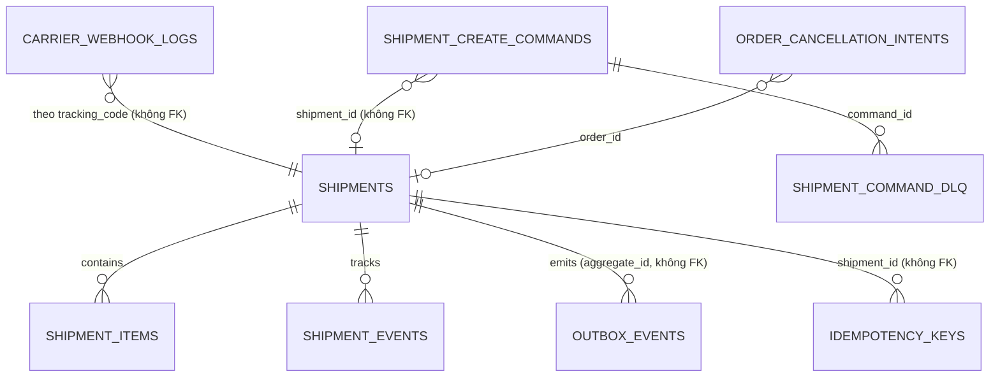

# Database — Shipment Service

> Nguồn: `docs/lld/shipment.md` · `docs/api/shipment.md` · Code: `ecommerce-taca/shipment-service` @ `develop` (`a375a41`) · Cập nhật: `2026-10-31`
> Trạng thái triển khai: ✅ Đã triển khai — schema do Flyway `V001`–`V006` tạo; Hibernate `ddl-auto=validate`.
> Baseline: MySQL 8.4/InnoDB, database `shipmentdb`, `utf8mb4` / `utf8mb4_0900_ai_ci`

## 1. Quy ước chung

| Quy ước | Quyết định | Ràng buộc |
|---|---|---|
| ID | ID của Shipment là UUIDv7 lưu `BINARY(16)`; API trả `shp-<uuid>`. | ID của Order/Shop/User là chuỗi opaque `VARCHAR(80)`, không FK chéo service. |
| Time | `DATETIME(6)` UTC (`hibernate.jdbc.time_zone=UTC`). | API/event ISO-8601. |
| Tiền | `BIGINT` đơn vị nhỏ nhất của `currency` (`CHAR(3)`, không default từ `V004`). | Không quy đổi tỉ giá. |
| Snapshot | Address/item snapshot nhận từ Order, lưu JSON. | Không query UserDB/OrderDB; không trả address trong API read; không log. |
| Carrier event | `(carrier, external_event_id)` unique ở `shipment_events` và `carrier_webhook_logs`. | Webhook at-least-once, idempotent. |
| Optimistic lock | `shipments.version` (JPA `@Version`). | Cancel so version từ request. |
| Migration | Flyway `classpath:db/migration`; không sửa migration đã chạy, không có down migration. | Thay đổi schema = file `V00x` mới. |

## 2. Quan hệ

FK thật chỉ có `shipment_items.shipment_id` và `shipment_events.shipment_id` → `shipments.id`.

## 3. Chi tiết bảng

### 3.1 `shipments`

| Cột | Kiểu | Null | Ghi chú |
|---|---|---|---|
| `id` | `BINARY(16)` | No | PK, UUIDv7. |
| `order_id` | `VARCHAR(80)` | No | Shop Order ID. |
| `checkout_group_id` | `VARCHAR(80)` | Yes | |
| `shop_id` | `VARCHAR(80)` | No | |
| `buyer_user_id` | `VARCHAR(80)` | No | So với `X-User-ID` ở route buyer. |
| `buyer_email` | `VARCHAR(254)` | Yes | Bắt buộc ở API create; nullable cho dữ liệu cũ. Đưa vào payload `shipment.delivered`/`shipment.failed`. |
| `carrier` | `VARCHAR(16)` | No | `GHN`, `SPX`, `J_AND_T`, `MOCK` (tên enum; API trả `J&T`). |
| `tracking_code` | `VARCHAR(64)` | Yes | Null khi đang `PENDING_RECONCILIATION`. |
| `status` | `VARCHAR(32)` | No | `ShipmentStatus` (§5). |
| `from_address_snapshot`, `to_address_snapshot` | `JSON` | No | ≤16 KiB mỗi cái (validate ở service). |
| `shipping_fee` | `BIGINT` | No | **Deprecated**: phí hiệu lực cũ (= quote nếu có, ngược lại = phí request). |
| `checkout_shipping_fee` | `BIGINT` | Yes | `V005`. Phí checkout Order gửi trong `shipping_fee` của request. Null với dòng cũ. |
| `carrier_quoted_fee` | `BIGINT` | Yes | `V005`. Quote lúc create; null nếu adapter không trả phí. |
| `carrier_actual_fee` | `BIGINT` | Yes | `V006`. Chỉ ghi khi có phí thực tế đã xác thực; hiện chưa có nguồn. |
| `currency` | `CHAR(3)` | No | Không default từ `V004`. |
| `cod_amount` | `BIGINT` | No | Default 0. |
| `estimated_delivery_min_date`, `estimated_delivery_max_date` | `DATE` | Yes | Từ `estimate.min_days/max_days` của quote. |
| `external_shipment_id` | `VARCHAR(128)` | Yes | ID phía carrier, không trả ra API. |
| `create_idempotency_key` | `VARCHAR(128)` | No | Dùng cho đối soát. |
| `version` | `BIGINT` | No | Default 1. |
| `created_at`, `updated_at` | `DATETIME(6)` | No | |

Dòng tạo trước `V005`/`V006` không được backfill phí tường minh vì không khôi phục chắc chắn được.

### 3.2 `shipment_items`

`id BINARY(16)` PK, `shipment_id BINARY(16)` FK, `sku_id VARCHAR(80)`, `product_id VARCHAR(80) NULL`, `title_snapshot VARCHAR(255)`, `quantity INT` (`CHECK quantity > 0`), `weight_grams INT NULL`, `created_at`. Snapshot bất biến. Kích thước `length_cm/width_cm/height_cm` nhận ở API nhưng **không** lưu.

### 3.3 `shipment_events`

`id`, `shipment_id` FK, `carrier VARCHAR(16)`, `canonical_status VARCHAR(32)`, `carrier_status VARCHAR(80) NULL`, `description_safe VARCHAR(500) NULL`, `source VARCHAR(24)` (`SYSTEM`/`CARRIER`/`RECONCILIATION`), `external_event_id VARCHAR(128) NULL`, `occurred_at`, `received_at`. Đây là timeline trả ở API read.

### 3.4 `carrier_webhook_logs`

`id`, `carrier`, `external_event_id VARCHAR(128)`, `payload_hash CHAR(64)` (SHA-256 raw body), `signature_valid BOOLEAN`, `status VARCHAR(24)` (`RECEIVED`, `PROCESSED`, `REJECTED`, `UNKNOWN_STATUS`, `IGNORED_OLD`), `safe_error_code VARCHAR(80) NULL` (`TRACKING_NOT_FOUND`, `CARRIER_STATUS_UNKNOWN`, `EVENT_OCCURRED_BEFORE_LATEST`, `INVALID_OR_STALE_TRANSITION`), `received_at`, `processed_at`. **Không** lưu raw body.

### 3.5 `idempotency_keys`

PK `(idempotency_key VARCHAR(128), operation VARCHAR(32))` với `operation` ∈ `CREATE`, `CANCEL`; `request_hash CHAR(64)`, `state VARCHAR(24)` (`PROCESSING`, `PENDING_RECONCILIATION`, `COMPLETED`), `shipment_id BINARY(16) NULL`, `response_snapshot JSON NULL`, `created_at`, `expires_at` (24h). Key hết hạn bị xoá khi gặp lại.

### 3.6 `outbox_events`

`id`, `aggregate_type VARCHAR(40)` (`SHIPMENT`, `SHIPMENT_COMMAND`), `aggregate_id VARCHAR(80)`, `event_type VARCHAR(100)`, `topic VARCHAR(160)`, `event_key VARCHAR(160)`, `payload JSON` (envelope đầy đủ), `headers JSON NULL`, `status VARCHAR(16)` (default `PENDING`; các giá trị `PENDING`, `PUBLISHED`, `DLQ_PENDING`, `DEAD`), `attempts`, `next_attempt_at`, `created_at`, `published_at`, `last_error_code`, `lease_token CHAR(36) NULL`, `lease_until DATETIME(6) NULL` (`V002`).

### 3.7 Bảng cho Kafka consumer (opt-in, `V003`)

| Bảng | Nội dung chính |
|---|---|
| `shipment_create_commands` | PK `command_id`; `request_hash`, `shop_order_id`, `idempotency_key`, `correlation_id`, `causation_id`, `payload JSON`, `original_message MEDIUMTEXT`, `source_topic/partition/offset`, `status` (`CHECK` ∈ `ACCEPTED`, `PROCESSING`, `RETRY_WAIT`, `PENDING_RECONCILIATION`, `COMPLETED`, `REJECTED`, `DEAD`), `attempts`, `next_attempt_at`, `lease_token`/`lease_until` (cùng null hoặc cùng có), `shipment_id`, `error_code`, `error_message_safe`, `replay_count`, `replayed_by`, timestamps. |
| `order_cancellation_intents` | PK `order_id`; unique `event_id`; `correlation_id`, `reason`, source Kafka coordinates, `original_message`, `status` (`CHECK` ∈ `RECEIVED`, `PROCESSING`, `WAITING_RECONCILIATION`, `RETRY_WAIT`, `APPLIED`, `NEEDS_OPERATOR`), lease, error, replay fields. Là tombstone chặn create sau khi order đã huỷ. |
| `shipment_command_dlq` | `id BIGINT AUTO_INCREMENT`; `command_id`, `original_message`, source coordinates, `attempts`, `error_code`, `error_message_safe`, `created_at`, `replayed_at`, `replayed_by`. |
| `shipment_command_replay_audit` | `id BIGINT AUTO_INCREMENT`; `target_type`, `target_id`, `operator_id`, `request_id`, `replayed_at`. |

`original_message` có thể chứa address/email buyer — cần hạn chế quyền truy cập và có retention policy.

## 4. Index

| Bảng | Index |
|---|---|
| `shipments` | unique `uk_shipments_order_shop (order_id, shop_id)`; unique `uk_shipments_carrier_tracking (carrier, tracking_code)`; `(buyer_user_id, created_at)`; `(shop_id, status, created_at)`; `(status, updated_at)`; `(create_idempotency_key)` |
| `shipment_items` | `(shipment_id)`; `(sku_id, created_at)` |
| `shipment_events` | unique `uk_shipment_events_carrier_external (carrier, external_event_id)`; `(shipment_id, occurred_at)` |
| `carrier_webhook_logs` | unique `uk_carrier_webhook_event (carrier, external_event_id)`; `(status, received_at)` |
| `idempotency_keys` | PK `(idempotency_key, operation)`; `(expires_at)` |
| `outbox_events` | `(status, next_attempt_at, created_at)`; `(aggregate_type, aggregate_id, created_at)`; `(status, next_attempt_at, lease_until, created_at)` |
| `shipment_create_commands` | `(status, next_attempt_at, lease_until, created_at)`; `(shop_order_id, status)`; `(idempotency_key)`; `(shipment_id)` |
| `order_cancellation_intents` | unique `(event_id)`; `(status, next_attempt_at, lease_until, created_at)` |
| `shipment_command_dlq` | `(command_id, created_at)`; `(created_at, replayed_at)` |
| `shipment_command_replay_audit` | `(target_type, target_id, replayed_at)` |

Vi phạm `uk_shipments_order_shop` → `409 SHIPMENT_ALREADY_EXISTS`; `uk_shipments_carrier_tracking` → `409 SHIPMENT_TRACKING_CONFLICT`; trùng unique webhook → `200 duplicate`.

## 5. Enum và rules

| Enum | Giá trị lưu DB |
|---|---|
| `ShipmentStatus` | `CREATED`, `PICKED_UP`, `IN_TRANSIT`, `DELIVERED`, `FAILED`, `CANCELLED`, `PENDING_RECONCILIATION`. |
| `Carrier` | `GHN`, `SPX`, `J_AND_T`, `MOCK`. |

`NOT_CREATED` **không** phải giá trị của Shipment: nó là giá trị ảo do Order-Commerce hiển thị khi chưa có shipment; Shipment API trả `404 SHIPMENT_NOT_FOUND`.

Rules: một dòng `shipments` mỗi `(order_id, shop_id)`; tracking code unique theo carrier; `DELIVERED` chỉ do webhook carrier; state machine xem LLD §5.

## 6. Migration và seed

### 6.1 Thứ tự migration (Flyway)

| File | Nội dung |
|---|---|
| `V001__create_shipment_tables.sql` | `shipments`, `shipment_items`, `shipment_events`, `carrier_webhook_logs`, `idempotency_keys`, `outbox_events` kèm toàn bộ index/unique. |
| `V002__add_outbox_claim_lease.sql` | `outbox_events.lease_token`, `lease_until`, index lease dispatch. |
| `V003__add_shipment_command_inbox.sql` | `shipment_create_commands`, `order_cancellation_intents`, `shipment_command_dlq`, `shipment_command_replay_audit`. |
| `V004__require_explicit_shipment_currency.sql` | Bỏ default `'VND'` của `shipments.currency`. |
| `V005__separate_checkout_and_carrier_quote_fees.sql` | Thêm `checkout_shipping_fee`, `carrier_quoted_fee` (nullable). |
| `V006__add_carrier_actual_fee.sql` | Thêm `carrier_actual_fee` (nullable). |

### 6.2 Seed

Repo **không** có migration seed. Dữ liệu test do test tạo (Testcontainers MySQL: `OutboxClaimServiceMySqlTest`, `ShipmentFeeMigrationMySqlTest`). Đề xuất fixture cho QA thủ công: shipment `MOCK` ở từng trạng thái, một webhook trùng `external_event_id`, một webhook event cũ hơn, một idempotency key còn hạn. Không seed credential carrier hay địa chỉ thật.

### 6.3 Kiểm tra trước khi chạy migration production

1. Không có `(order_id, shop_id)` hoặc `(carrier, tracking_code)` trùng trên DB có sẵn dữ liệu.
2. Kiểm tra round-trip UUID ↔ `BINARY(16)` với Hibernate/MySQL 8.4.
3. Có retention cho `idempotency_keys` hết hạn, `outbox_events` `DEAD`, inbox có PII.
4. Không hard-delete `shipment_events`/`carrier_webhook_logs` khi chưa có retention policy.

## 7. Giả định & câu hỏi mở

| # | Nội dung | Ảnh hưởng nếu sai | Cần ai xác nhận |
|---|---|---|---|
| 1 | Một Shop Order có một `shop_id` bất biến nên `(order_id, shop_id)` = một shipment/Shop Order. | Có thể tạo trùng. | Order owner |
| 2 | Kích thước kiện (`length_cm`…) không lưu. | Đối soát phí theo thể tích không được. | Shipment/Finance |
| 3 | Inbox lưu message gốc chứa PII. | Rủi ro privacy. | Security/Data |
| 4 | Multi-package, return/exchange chưa có schema. | Cần bảng mới nếu bật. | Product |
